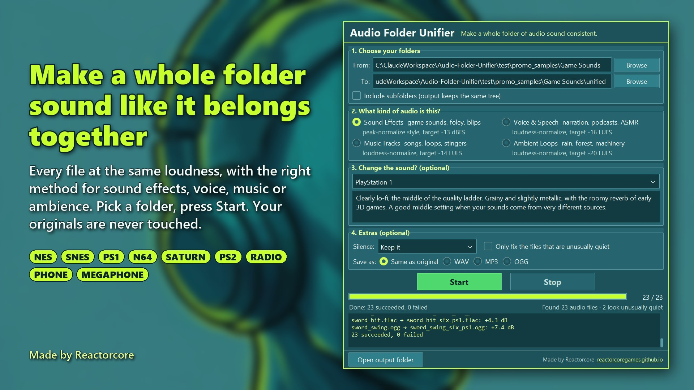

# Audio Folder Unifier

**Make a whole folder of audio sound like it belongs together.**

You've collected sounds from all over the place: some are quiet, some blast your ears, some are crisp studio recordings and some are crunchy old clips. Audio Folder Unifier takes the whole folder and writes out a new one where every file sits at the same loudness. If you want, it also gives them all the same character, from 8-bit console crunch to an old radio or a worn cassette tape.

One window. Pick a folder, pick what kind of audio it is, press Start. Your original files are never touched.

## What it does

- **Evens out loudness across a whole folder.** Four presets: Sound Effects, Voice & Speech, Music Tracks, Ambient Loops. Each one uses the right method for that kind of audio, including short game sounds and blips, which ordinary loudness tools get wrong.
- **Optional sound effects** that give every file the same character:
  - **Match everything to one quality level:** NES, SNES, PlayStation 1, Nintendo 64, Sega Saturn, PlayStation 2. Sounds from different sources come out with the same retro texture, so they finally feel like one set.
  - **Sounds like it's coming from:** a radio, a telephone, a megaphone, underwater, an old cassette tape, an old vinyl record, another room, plus Gritty and Brutal distortion.
  - **Polish & finish:** podcast polish, punchy sound effects, warm & fuzzy, bright & crisp.
- **Optional silence trimming**, either at the start and end only or everywhere in the file.
- **Finds the unusually quiet files** in a folder and can fix only those.
- **Saves as** the original format, WAV, MP3 or OGG. Reads WAV, MP3, OGG, OPUS, FLAC, M4A, AAC, AIFF and WMA.
- Handles subfolders (the output keeps the same folder tree), hundreds of files at once, and can be stopped at any time.

## Requirements

- Windows 10 or 11
- **FFmpeg** installed and on PATH. If you don't have it, this installer sets it up in one click: https://reactorcore.itch.io/ffmpeg-to-path-installer

The program tells you if FFmpeg is missing.

## Quick start

1. Unzip anywhere and run `Audio Folder Unifier.exe`. No installation.
2. Click **Browse** next to "From" and pick your folder of audio.
3. Pick what kind of audio it is.
4. Press **Start**. The results appear in a `unified` folder inside your folder.

See `guide.md` for everything else, and `stats-for-nerds.md` for the exact numbers behind every preset.

## Portable

Settings are saved to `config.json` and a log of every run to `log.txt`, both next to the exe. Move the folder anywhere, or delete it to uninstall.

## License

MIT, see `LICENSE`. Copyright (c) 2026 Reactorcore.

Third-party parts bundled in the program: Python, Tk, ttkbootstrap (MIT), NumPy (BSD), soundfile (BSD) with libsndfile (LGPL), Pillow (HPND). FFmpeg is not included; you install it yourself.

## Contact

mailto:reactorcoregames@gmail.com

---

Check out everything else I do: ✨🚀

https://reactorcoregames.github.io/

https://reactorcore.itch.io/

-Reactorcore

---

My other links:
Home/Links: https://reactorcoregames.github.io/
Releases: https://reactorcore.itch.io
Blog: https://www.patreon.com/ReactorcoreGames
Discord: https://discord.gg/UdRavGhj47
Backup links page: https://linktr.ee/reactorcore
